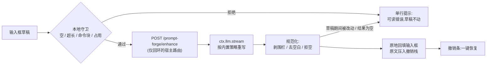

# Prompt Forge

**DeepSeek Harness Web GUI 的「提示词增强」插件** —— 一键把输入框里的草稿改写为结构化提示词：明确的角色与目标、可执行步骤、输出格式、验收标准、边界条件。不改变原意、不凭空编造需求，原文始终保留。

---

## 为什么需要它

好的智能体提示词会讲清*让模型扮演谁*、*交付什么*、*以什么格式*、*怎样算合格*——而大多数草稿不会。本插件给 dsh 输入框加上 WorkBuddy 风格的「增强」入口：草稿经低温重写（走 harness 自带的 LLM 服务），结果直接回填到输入框，输入框上方随即出现撤销条，一键即可还原。**任何失败路径都不会改动你输入的内容**，也不会用弹窗打断你。

## 功能一览

| | |
|---|---|
| ✨ **输入框按钮** | 工具栏内发送键旁的小按钮，随手可及 |
| ↩️ **一键撤销** | 回填后输入框上方出现撤销条，一键恢复原文 |
| ⌨️ **快捷键** | 默认 `Ctrl+Alt+E` 可配置，作用于你正在使用的输入框 |
| 💬 **`/enhance` 命令** | 斜杠面板直接改写任意文本；结果不进入模型历史 |
| 🧠 **模型路由** | 设置成对覆盖 → 当前会话模型 → 全局默认模型，依次回退 |
| 🔑 **零凭据配置** | 调用走 harness LLM 服务，密钥来自 harness 凭据存储 |
| ⚙️ **配置热生效** | 模型覆盖、温度、预算、系统提示词、快捷键，全部在 设置 → 插件配置 即改即用 |
| 🛡️ **草稿安全** | 空输入、超长、仅图片、含命令块在本地拦截；上游失败映射为可读提示；失败绝不改动草稿 |
| 🔔 **非阻塞提示** | 所有错误与状态都以一行会自动消失的提示呈现：没有弹窗、没有按钮、没有需要你做的决定 |

## 工作原理



插件是单个 npm 包、双半区结构，完全遵循 dsh 插件规范：

- **宿主半区**（`exports "."`，Node）：声明 `prompt-forge` 设置 schema（schemastery，每个字段带 `.volatile()`——宿主的 `describe()` 会**跳过没有任何 volatile 字段的条目**，这个标记既是"设置页会出现"的前提，也是"改完下次请求就生效"的契约；插件在**每次请求时**重新读取，而不是缓存启动快照），注册共享 webserver 上的 `POST /prompt-forge/enhance` 路由（仅回环、限长），以及 `/enhance` 斜杠命令。模型调用走 `ctx.llm.stream` 并做规范化处理——与 harness 对会话标题相同的辅助调用纪律：超时与调用方取消在流过程中和结束后复查、终结 finish 校验、拒绝工具调用。
- **浏览器半区**（`exports "./client"`）：把增强按钮注册进 `conversation.input.right` 插槽、撤销条注册进 `conversation.input.dock` 插槽，绑定设置命名空间的实时镜像，并安装全局快捷键。全部文案经 harness locale 系统提供中英双语。

## 环境要求

- `dsh >= 0.1.1-rc.2 < 0.3.0` —— 这个区间表示**实际验证过的范围**，而不是无限期的承诺。`dsh.engines` 是强制的：宿主启动预检会把不匹配的条目直接 `disabled = true`，所以区间写错的结果是**插件不加载**。
- 实测环境：`0.1.1-rc.2`、`0.1.2-alpha.3`、`0.1.7-rc.2`、`0.2.0-rc.2`、`0.2.1-rc.2`、`0.2.1-rc.5` 均已 boot 验证（插件层挂载、增强路由应答、客户端 bundle 构建通过）。插件对 `@deepseek-ai/dsh-settings`、`dsh-agent-default-model`、`ctx.settingsScope` / `ctx.configForms` 的历代形态均做运行时探测并自动适配，无需配置。
- Node `^22.19.0 || >=24.0.0`（仅从源码构建时需要）。
- 浏览器侧 peer `react` / `react-dom`（`^18.2.0`）由 Web 壳的模块注册表提供。宿主半区用到的 `@deepseek-ai/dsh-llm` 是**由 dsh 宿主提供的运行时模块，不从 npm 安装**，因此声明为**可选** peer：未提供它的环境不会出现安装警告，增强时按正常错误路径报错，而不是加载失败。

| | |
|---|---|
| dsh | `>= 0.1.1-rc.2 < 0.3.0` |
| Node | `^22.19.0 \|\| >=24.0.0` |
| 插件 | `0.1.3` |

## 安装

仓库本身就是插件包 —— 根目录的 `package.json`、`cordis.patch.yml` 与已编译的 `lib/` —— 所以 dsh 可以直接从 GitHub 安装：

```bash
dsh plugin --profile web add github:yuanxing109/dsh-prompt-forge
# 重启 dsh web
```

写成完整 URL 也可以（`dsh plugin --profile web add https://github.com/yuanxing109/dsh-prompt-forge`），本地克隆同理：

```bash
git clone https://github.com/yuanxing109/dsh-prompt-forge.git
dsh plugin --profile web add link:<repo>
# 重启 dsh web
```

`lib/` 已随仓库提交，安装就是一次克隆加一次链接，不需要构建、不需要工具链。

`installer/` 另带一套 Windows 离线安装器：`install.bat` 探测 dsh 安装目录与 profile，把插件复制到 `<profile>\vendor\`，改好清单，逐文件校验哈希，失败即回滚；`uninstall.bat` 与 `verify.bat` 负责还原与核对。[installer/README.md](./installer/README.md) 写清了每一步。

改代码：TypeScript 源码在 `src/`，实际运行的 JavaScript 在 `lib/`。完整重建需要 `tsc` 与项目的 `scripts/build.mjs`，本包没有随附 —— 要么手工让 `src/` 与 `lib/` 保持一致，要么从上游项目取回工具链。

卸载：

```bash
dsh plugin --profile web remove dsh-prompt-forge
# 检查 profile 的 package.json `dsh.profile.bundles` 数组里是否残留
# "dsh-prompt-forge" 行，有则删掉，然后重启 dsh web
```

## 使用方法

**输入框按钮 / 快捷键** —— 输入（或留着）草稿，点 ✨ 或按 `Ctrl+Alt+E`：

1. 先跑本地守卫：空草稿、超长草稿（**不自动截断**——截断会改变原意）、仅图片草稿，都会被拒绝并给出一行提示。草稿里的文件引用会跟着结果一起搬回输入框：按每条引用的字符在增强文本里重新定位，模型漏掉的补在末尾，重复的路径合并成一条。
2. 按钮在原地转圈，点它即取消。结果回来之前草稿原封不动；**失败不会打开任何面板**——只有一行会自己消失的提示。
3. 结果回来即**原地回填**到输入框，原文压入撤销栈；输入框上方出现撤销条。
4. 两种情况不自动回填，改为一行提示说明原因：增强期间你改动了草稿（回填会覆盖你的新编辑），或模型返回了空结果。
5. 撤销记录**只存在于当前页面内存**（每个会话最多 3 条），刷新页面、重启 Web 或切换会话后即失效。

**`/enhance <文本>`** —— 从斜杠菜单改写任意文本。结果在命令面板渲染（可复制），不进入会话历史与模型上下文。要增强**输入框里的草稿**请用按钮或快捷键——草稿在浏览器里。正在运行的 `/enhance` 取消跟随 harness 命令面板能力；客户端未提供取消入口时，调用会执行到完成或超时。

**语言一致性**：重写策略默认要求模型保持输入语言（中文进中文出）——尽力而为的约束，无法严格保证。

## 配置

全部配置位于 `prompt-forge` 设置命名空间，在 Web GUI 的 **设置 → 插件配置** 页编辑。改动作用于下一次调用——无需重启。每次增强都是一次计费的 LLM 调用——`reasoningEffort` 与 `maxOutputTokens` 约束单次花多少 token，并发/限流字段约束调用频率。

| 字段 | 默认 | 说明 |
|---|---|---|
| `enabled` | `true` | 总开关；关闭隐藏按钮并停用所有触发方式 |
| `provider` + `model` | 空 | 显式路由覆盖；必须**成对**填写（或都留空以跟随当前会话模型） |
| `temperature` | `0.3` | 低温使改写更忠实于原意 |
| `reasoningEffort` | `off` | 随调用发送的推理预算：`off` / `low` / `high` / `inherit`（不传该字段、完全跟随模型默认档）。同一句话实测：`high` 花 **2897** 输出 token，`off` 只花 **252**。声明无推理能力的模型会自动摘掉该字段重试一次，所以这个设置不会让这类路由失败 |
| `maxOutputTokens` | `8192` | 单次增强调用的输出 token 预算 |
| `maxInputChars` | `12000` | 输入字符数上限（按 Unicode 字符统计，不是 token 数；一个 emoji 算一个字符）；超限**拒绝而不截断** |
| `timeoutMs` | `180000` | 单次调用的端到端超时。默认 3 分钟：自定义 OpenAI 兼容端点单次改写实测要 38 秒，旧的 60 秒默认会把这类调用判成超时 |
| `systemPrompt` | 内置策略 | 自定义增强策略文本；与内置策略如何组合见 `strategyMode` |
| `strategyMode` | `replace-default` | `replace-default` **整体替换**内置策略（「不改变原意、不编造、只输出正文、镜像输入语言」等硬性约束不会自动保留，需自行写入）；`extend-default` 把自定义文本**追加在内置策略之后**，硬性约束继续生效 |
| `shortcut` | `ctrl+alt+e` | 快捷键规格（至少一个修饰键 + 单个字母/数字/功能键——纯裸键会被忽略，绝不会吞掉正常打字）；留空禁用 |
| `maxConcurrent` | `2` | **单个 Host 进程内**的并发上限；超出的请求返回 `429`（`concurrency-limit`） |
| `rateLimitPerMinute` | `10` | **单个 Host 进程内**的每分钟滑动窗口限流，只统计**成功完成**的增强——失败（超时 / 上游错误 / 取消）不消耗窗口；超出返回 `429`（`rate-limit`），响应附 `Retry-After` 秒数 |
| `streaming` | `true` | 模型边写边计数进度，而非等整段写完——**仅影响等待体验**，最终文本仍是归一化的完整结果；宿主或网络不支持 `text/event-stream` 时客户端会自动回退为一次性 JSON 请求 |
| `contextAware` | `true` | 读取当前对话的近期历史，用于消解代词、补全已声明的约束、镜像已确立的栈与术语。**隐私：** 装配好的历史片段会随草稿一起发给当前配置的 LLM；若当前会话含密钥、token、内部代号等敏感内容，请关闭 `contextAware` |
| `contextMaxMessages` | `8` | 上下文窗口广度——最多参考多少条 user/assistant 轮；`0` 表示不参考 |
| `contextMaxChars` | `4000` | 上下文窗口深度——历史片段的字符预算，从最新一条起向前装配；`0` 表示不参考 |

**模型路由优先级：** 设置成对覆盖 → 当前会话请求头中记录的路由 → 全局默认模型（`agent-default-model`）。三者都指不出路由时（例如全新会话且无默认模型），插件给出可操作的报错而不是乱猜。

## 内置增强策略

默认系统提示词让模型扮演提示词重写专家，按草稿的实际需要施加：

1. **角色与目标** —— 写明助手扮演谁、交付物是什么。
2. **背景与约束** —— 只补全草稿可推断的信息；绝不编造事实、数据、名称或需求。
3. **步骤** —— 把模糊或多头需求拆成编号、可执行的步骤。
4. **输出格式** —— 在有暗示处指明结构、语言、长度与风格。
5. **验收标准** —— 写明怎样判断结果正确。
6. **边界条件** —— 列出边界情况与信息缺失时的做法。

硬性规则：精确保留原意（不删除、不篡改、不与用户信息冲突）；绝不编造——未知细节插入显式占位符如 `(待补充:…)` / `(TBD: …)`；保持任务范围不变；**只输出**改写后的正文（无解释、无围栏、无客套）；镜像输入语言；长度约为原文 1–3 倍；已经成形的提示词只做轻度润色而不注水。

在设置中填写 `systemPrompt` 即可自定义策略，组合方式由 `strategyMode` 决定：默认 `replace-default` 是**完全替换**——内置策略中的安全约束不会自动保留，自定义策略需要自行包含这些约束；改为 `extend-default` 则把你的文本追加在内置策略之后，硬性约束继续生效。

## 异常与边界

| 情形 | 行为 |
|---|---|
| 空 / 纯空白 / 零宽字符草稿 | 本地拒绝：「输入框为空」 |
| 草稿超过 `maxInputChars` | 本地与路由双重拒绝并给出精确字符数；**不自动截断** |
| 只附加了图片没有文本 | 拒绝：仅支持文本 |
| 草稿含文件引用块 | 保留引用：按引用字符重新锚定后写回；确实无法满足宿主引用协议时降级为纯文本，并用一行提示说明 |
| 提交中 / 占用阶段 / 已有请求在途 | 拒绝并提示「稍后再试」 |
| 增强期间草稿被改动 | 放弃本次结果，一行提示说明原因；草稿不动 |
| 模型返回空结果 | 一行提示，可重试 |
| 每分钟次数超限 | `429`（`rate-limit`），响应携带 `Retry-After` 秒数；窗口只统计成功完成的调用 |
| 并发已满 | `429`（`concurrency-limit`），无 `Retry-After`——等一个在途调用结束即可 |
| 上游模型失败 | 稳定错误码映射为可读提示：`AUTH` → 检查 API Key、`RATE_LIMIT` → 稍后重试、`QUOTA_EXCEEDED` → 检查余额、`CONTEXT_WINDOW_EXCEEDED` → 精简输入、`NO_ADAPTER`/未配置 → 先配置模型 |
| 输出达到 `maxOutputTokens` | 拒绝并提示调大上限或精简原文 |
| 模型返回围栏包裹 / 工具调用 | 规范化（剥围栏）或拒绝；可重试 |
| 超时 | 映射为 `504` 的提示并给出配置秒数；以单行提示呈现，不自动重试 |
| 浏览器中途关闭 | 宿主路由侦测连接断开，立即中止模型调用 |
| 切换会话 | 撤销栈、快捷键目标均按会话隔离；切换即清理 |

所有失败只以一行会自动消失的提示出现——没有弹窗、没有按钮；失败的调用绝不修改输入框草稿，手动输入不受任何干扰。

## 错误码与本地化

宿主路由返回的结构化错误形如 `{ code, message?, params? }`：主文案由浏览器按 `code` + `params` 从当前语言字典渲染，`message` 只是可选的诊断细节（如模型服务商的原始报错），原样展示在主文案之后。`/enhance` 命令平面没有 locale 字典，由宿主侧的同源渲染函数直接产出中文文本。

| 错误码 | HTTP 状态 | 浏览器主文案（字典键） | 参数 |
|---|---|---|---|
| `rejected` | 403 / 413 / 415 / 422 | `error.rejected` 通用；携带 `{ count, max }` 时复用 `error.tooLong` | 超长输入: `{ count, max }` |
| `rate-limit` | 429 | `error.rateLimit` | `{ limit, retryAfterSeconds }` |
| `concurrency-limit` | 429 | `error.concurrencyLimit` | `{ max }` |
| `timeout` | 504 | `error.timeout` | `{ seconds }` |
| `unconfigured` | 409 | `error.unconfigured` | — |
| `upstream` | 502 | `error.upstream` 通用；携带 `reason` 时用 `error.upstream.{reason}` | `{ reason }` |
| `internal` | 500 / 502 | `error.internal` | — |

## 故障排查

**按钮不出现 / 快捷键无响应**
设置 → 插件配置 → `prompt-forge` 节的 `enabled` 是否为 `true`；插件是否成功安装（`dsh plugin --profile web list`）并重启了 `dsh web`；浏览器控制台是否有插件应用报错。

**「尚未确定增强用的模型」**
路由优先级为 设置成对覆盖 → 当前会话模型 → 全局默认模型，三者都为空时无法调用。在设置中成对填写 `provider`/`model`，或先在当前会话发一条消息让会话带上模型路由。

**「鉴权失败」**
诊断细节行会带出具体原因（如 401）。检查对应 provider 在 harness 凭据存储中的 API Key；配额/余额问题对应 `quota` 提示。

**连续失败后立刻被限流（429）**
不应发生——限流窗口只统计成功调用，失败不消耗窗口。若仍遇到，确认是否同时挂载了多个 profile / 多进程（各自独立计数会叠加），或 `rateLimitPerMinute` 配置过低。

**结果不理想（编造、丢要求、格式乱）**
`strategyMode` 为 `replace-default` 时自定义 `systemPrompt` 会整体替换内置策略——内置硬性约束不会自动保留，请自行写入；或改用 `extend-default`。

**提示里说草稿被改动了**
增强是异步的：结果回来时若输入框内容已不同于发起时，插件会放弃回填，避免覆盖你的新编辑。重新点一次即可。

## 安全模型

增强路由由你自己的 dsh 宿主提供服务，**仅限本机访问**：

- **套接字栅栏** —— 非回环地址（`127.0.0.1` / `::1` 之外）的请求一律拒绝。注意这意味着*本机任意进程*都可以调用该路由；路由本身不带用户鉴权。
- **Host 白名单** —— 路由同时校验 `Host` 头是否为 `localhost` / `127.0.0.1` / `[::1]`，可防御 DNS 重绑定。响应均为 `cache-control: no-store`。
- **滥用上限** —— `Origin` 门拒绝来自非本地页面以及其他本地端口的浏览器调用；路由还执行并发上限（`maxConcurrent`）与每分钟限流（`rateLimitPerMinute`），超限返回 `429`。这两项计数保存在**单个宿主进程的内存中**。
- **代理请求拒绝** —— 携带 `X-Forwarded-For` / `Forwarded` 头的请求直接拒绝。
- **不要经反向代理暴露** —— 若把 dsh web 放在监听局域网的代理后面，外部调用者在路由看来就是回环地址，栅栏形同虚设。
- **提示注入边界** —— 草稿被框在 `<raw_prompt>` 标签之间，草稿内的字面闭合标签会被中和，策略提示词把框内文本视为纯数据——降低简单标签逃逸的风险；基于提示词的边界是尽力而为，并非完整防护。
- **会话上下文数据外发** —— `contextAware` 默认开启时，近期 `user`/`assistant` 历史会随草稿一起发给当前配置的 LLM。该历史可能携带密钥、token、内网主机名等，模型提供方会**原文看到**。把 `contextAware` 视为隐私边界。

## 架构

```
src/
├── index.ts            宿主 apply():设置节 + 路由 + 命令
├── config.ts           schemastery 模式 + 解析校验(成对路由)
├── prompts.ts          内置策略系统提示词 + <raw_prompt> 框架
├── enhancer.ts         ctx.llm 辅助调用(路由解析、超时竞速、finish 校验)
├── enhance-routes.ts   POST /prompt-forge/enhance 与 /enhance-stream
├── enhance-command.ts  /enhance 斜杠命令(宿主命令注册表)
├── orchestrate.ts      两条宿主入口共用的路由解析 + 上下文装配
├── context.ts          有界、去框架化的 <conversation_context> 片段
├── loopback.ts         路由的 127.0.0.1/::1 栅栏
├── http.ts             限长 JSON body 读取 / 写出
├── sse.ts              带背压的 SSE 帧写入器
├── shared/             传输协议类型、输入校验、输出规范化(两端共用)
└── client/             浏览器半区
    ├── index.tsx       插槽注册 + 设置镜像 + 快捷键监听
    ├── EnhanceButton   conversation.input.right 条目:守卫链 + 调用编排 + 提示
    ├── errors.ts       错误码 → 本地化文案(无 UI 依赖)
    ├── UndoBar         conversation.input.dock 条目:恢复入口
    ├── ui-state.ts     组件共享的外部 store(进行中状态、撤销、会话注册表)
    ├── enhance-client  fetch 客户端(可中止 + 类型化错误;SSE 与一次性两条路径)
    ├── undo-stack.ts   按会话的 LIFO 栈(每会话深度 3,全局 60 条,LRU 淘汰)
    ├── session-key.ts  每个输入框的 UI key(宿主 sessionId,否则稳定兜底 id)
    ├── shortcut.ts     纯函数的组合键解析 / 匹配
    ├── settings.ts     设置命名空间的客户端镜像
    ├── locales.ts      中英文字典(harness locale 命名空间)
    └── styles.ts       自注入样式表(dsh-pf- 前缀类名)
```

构建产物：`lib/index.js`（宿主半区，ESM，包引用保持外部）与 `lib/client.js`（浏览器半区，打包为 CJS 并包进 dsh web 壳要求的 `window.__ModuleLoader__.load({ id, factory })` 信封）。两者都随仓库提交，因此 GitHub 直装无需构建。

## 开发

```bash
npm install
npm run typecheck     # tsc --noEmit
npm test              # 单元 + 真实 HTTP + 组件测试套件
npm run build         # 类型检查 + 双半区构建
npm run watch         # esbuild 监听构建双半区
```

日常调试闭环：先用 `dsh plugin --profile web add link:...` 装一次，再挂 `npm run watch`；宿主半区改动需重启 `dsh web`，浏览器半区改动刷新页面即可。

## FAQ

**草稿里的 `@文件引用` 回填后会怎样？**
引用会被保留，而不是变成普通文本。写回前逐条按引用的 `clipboardText` 在增强文本里重新定位，并按宿主的草稿 schema 校准偏移、长度、升序与不重叠（`offset + length` 必须落在文本内，`text.slice(offset, end)` 必须等于引用文字）。模型漏掉某条引用就补在文本末尾，重复出现的同一路径只保留一个引用块——这同时避免了「一个引用变两个」和「引用退化成 `@路径` 文本」。若某条引用实在无法组成合法区间，整次写回降级为纯文本，并给出一行提示：本次未能保留文件引用。

**为什么旧版本会出这两个问题？**
旧实现把每条引用的偏移统一设成 `text.length`（文本末尾），这既让正文里的 `@路径` 与末尾引用块重复，又让 `offset + length > text.length` 违反宿主校验——持久化的草稿随后解析失败，引用记录被丢弃，只剩字符。现在的写回先算好合法区间再调用 `setDraft`，并对撤销恢复走同一套校验。

**为什么不自动截断超长输入？**
截断会无声地改变你的原意——插件宁可拒绝并给出精确字符数。

**能固定用某个模型吗？**
在设置中**成对**填写 `provider` 与 `model`。都留空则跟随当前会话模型。

**我的草稿会被发到哪里？**
浏览器 → 你自己的 dsh 宿主（仅回环路由）→ harness LLM 服务 → 配置的模型服务商。不会发往其他任何地方，增强行为也绝不进入会话的模型历史。

**结果去哪了？为什么没有对比窗口？**
本版本不再使用浮层预览：结果直接回填，原文进入撤销栈，一键可还原。失败与异常只用一行提示说明，不打断输入。

## 安装后手工冒烟清单

安装并重启 `dsh web` 后：

1. 设置 → 插件配置 出现 `prompt-forge` 配置节。
2. 发送键旁出现 ✨ 按钮，悬停显示「重写为结构化提示词」；`Ctrl+Alt+E` 触发相同流程。
3. 空输入 → 一行提示；有效草稿 → 原地回填 + 撤销条；点撤销恢复原文。
4. `/enhance <文本>` 输出可复制结果，且不进入模型历史。
5. 三种模型路由都通：设置成对覆盖、会话模型、全局默认模型。

## 更新日志

- `0.1.3`（2026-11-18）
  - 修复：增强后文件引用（chip）失效。模型把 `@路径` 规范化成裸路径时，chip 会掉到文末、正文里还留一份重复路径；现在按 `clipboardText` → 去掉 `@` 的裸路径 → chip 标签 依次回退匹配，命中裸路径时原位还原为 `@路径` 并挂回 chip，多处重复仍只保留一个 chip。
  - 修复：匹配裸路径加了路径边界判断，`src/a.ts` 不会再误命中 `src/a.tsx`。
- `0.1.2` —— 写回改为语义草稿（`{ text, references }`），引用不再退化成纯文本。
- `0.1.1` —— 失败提示改为单行自消失 notice；✨ 按钮补回「重写为结构化提示词」tooltip；默认超时 3 分钟。

## 致谢

插件结构、回环栅栏与设置节模式遵循 dsh 插件家族的既有惯例——特别是 [`@linxin666/dsh-tool-describe-image`](https://www.npmjs.com/package/@linxin666/dsh-tool-describe-image)。

## 许可证

[Apache-2.0](./LICENSE)
